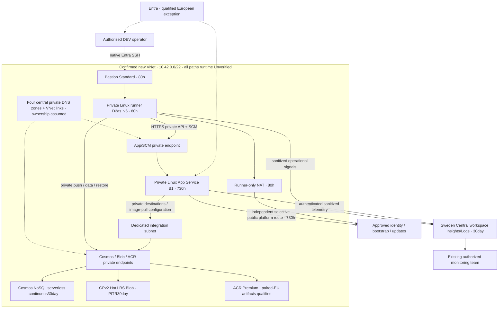
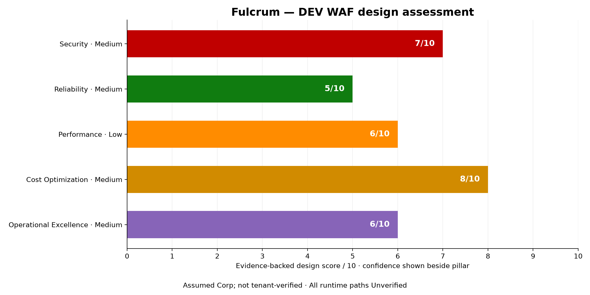

# 🏛️ Step 2: Architecture Assessment - Project Fulcrum

[Review and approval status](README.md#-workflow-progress)

<strong>📑 Assessment Contents</strong>

- [✅ Requirements Validation](#-requirements-validation)
- [💎 Executive Summary](#-executive-summary)
- [🏛️ WAF Pillar Assessment](#-waf-pillar-assessment)
- [📦 Resource SKU Recommendations](#-resource-sku-recommendations)
- [🎯 Architecture Decision Summary](#-architecture-decision-summary)
- [🚀 Implementation Handoff](#-implementation-handoff)
- [🔒 Approval Gate](#-approval-gate)
- [References](#references)

> Generated by 03-Architect agent | 2026-11-09

**Assumed Corp policies—not tenant-verified; DEV Architecture-only.**
This is a greenfield design, not an as-built assessment. Every runtime path is **Unverified**.
No application/IaC generation, Azure operation, spending or deployment is authorized.

| ⬅️ Previous | 📑 Index | Next ➡️ |
| --- | --- | --- |
| [Requirements](01-requirements.md) | [README](README.md) | [Cost estimate](03-des-cost-estimate.md) |

## ✅ Requirements Validation

| Requirement area | Status | Validation notes |
| --- | --- | --- |
| Availability / recovery | ✅ Defined | DEV occasional downtime accepted; RTO4h/RPO1h for recoverable logical/deletion/application faults. Regional recovery is provider-dependent, not a local-backup promise. |
| Performance / scale | ✅ Defined, untested | Up to50 daily testers,10–100 concurrent; typical API under2s planning goal. Adopted20RPS/1000RU/s peak envelopes require load verification, not average-demand extrapolation. |
| Compliance | ⚠️ Qualified | Fictional DEV only, security/privacy baseline mandatory. GDPR-aligned intent is not legal certification or a future PROD waiver. |
| Budget | ✅ Defined | Owner's USD500–2,000/month soft planning range, not a hard cap or spending approval; minimal cost-monitoring mode. |
| Security / ownership | ✅ Designed | Entra/MI, platform HTTPS, private API/data/images, existing monitoring team; all application code/tests belong to another team. Exact identities are later secure bindings. |
| Residency | ⚠️ Explicit exceptions | Workload compute/app data/Blob/backups/monitoring Sweden Central only; qualified European Entra processing and Microsoft-managed paired-EU registry artifacts are the only accepted exceptions. |
| Inputs / prior approval | ✅ Current | [69-input projection](_meta/assessment-step-2.json); current Step1 completion and [actual Gate1](_meta/01-gate1-acr-revision-response-receipt.json). Pending wording in frozen Requirements is historical. |
| Effective policy | ⚠️ Assumed only | [Hash-bound Corp acceptance](_meta/02-assumed-corp-acceptance-receipt.json); no tenant target, inventory, exemptions, quota or live policy inspected. |

### Required Capability Dependencies

Every row is **Designed**, including its explicitly qualified ownership assumptions;
none is claimed implemented. Full hop-by-hop evidence and security semantics:
[dependency closure](_meta/02-final-dependency-closure.md).

| Required capability | Consumer / producer | Dependencies and accountable owner | Evidence scope / date | Design status | Runtime status |
| --- | --- | --- | --- | --- | --- |
| Private API / SCM access | Authorized DEV clients/operators | Operator → native Entra SSH through Standard Bastion → private Linux runner → app/SCM PE443; correct app+SCM DNS records/link. Application team owns issuer/audience/role enforcement. No physical-phone/VPN/P2S promise. | Official App Service/Bastion guides + actual ephemeral-client choice;2026-11-09 | Designed | Unverified |
| Private container delivery | Image publisher / App Service MI | Runner short-lived Entra push → ACR PE; host integration/configuration image-pull route → private registry login/regional data endpoints; permission-mode-compatible pull grant. Image/digest supplied by application team. | MI pull, ACR Private Link + accepted artifact exception;2026-11-09 | Designed | Unverified |
| Document CRUD | Backend MI / NoSQL account | App integration/runner → Cosmos PE443, Gateway HTTPS SDK mode, native data-plane RBAC, local keys disabled, correct documents zone/link. | Cosmos native RBAC/private networking + approved SKU;2026-11-09 | Designed | Unverified |
| Private media/documents | Backend MI / Blob | Container-scoped Entra data roles, no shared key/public Blob, Blob PE443 and zone/link; backend mediates client access. | Blob authorization/PITR guidance + LRS lock;2026-11-09 | Designed | Unverified |
| Runner bootstrap / management | Platform operators | Gen2 Ubuntu/Trusted Launch eligible image, MI/Entra SSH extension and login grants; runner-only NAT for identity, ARM, extensions, packages/updates/Monitor; DNS53 and Bastion SSH22 NSG rules. No public VM NIC. | Bastion/native Entra, NSG and explicit outbound guides;2026-11-09 | Designed | Unverified |
| Continuous app egress / telemetry | App / monitoring team | Private data and configuration image pull via integration; permitted public identity/control/authenticated Monitor via independent platform route for730h. Never route app through80h runner NAT. Supported server SDK, disable local telemetry auth; sanitized combined1GB ingestion. | App routing + Entra telemetry guides;2026-11-09 | Designed under assumed policy | Unverified |
| Recovery / reconstruction | Recovery operators / image team | Cosmos new same-region target → reapply PE/DNS/RBAC → endpoint cutover; Blob in-place PITR plus container protection/account deletion lock; recreate app/config/runner. Runbook includes access, restore progress, alerting and application validation owners. | Continuous30day backup/Blob prerequisites;2026-11-09 | Designed | Unverified |
| Central private DNS | Platform / Governance | Four service-specific zones, records and VNet links; actual DINE parameters, zone-group permissions and zone/link ownership must be verified. No duplicate project zones assumed deployed. | Shared Corp source + confirmed network;2026-11-09 | Designed assumption | Unverified |

## 💎 Executive Summary

Use a small managed modular-monolith-compatible platform: one Linux App Service B1,
one NoSQL serverless account, Standard GPv2 Hot LRS Blob and private ACR Premium.
An explicitly selected **ephemeral** Bastion/runner/NAT path enables private DEV
testing and operations without a project VPN, public API or public VM.
No edge, Kubernetes, broker, relational store, cache or extra application service is introduced.

The [COMPLETE pricing-owner scenario](contracts/02-cost-estimate.conservative-planning-v2.json)
covers all17 modeled billing lines at **USD168.104995/month** and
**USD2017.25994/year**. These are conditional conservative planning allocations,
not observed spend, actual tariff-band placement or an invoice prediction.
Corporate/shared charges outside the authorized project boundary remain unknown, not free.

### Subscription & Landing Zone Topology

| Logical scope | Planned resources | Shared dependencies | Evidence / gaps |
| --- | --- | --- | --- |
| DEV workload; subscription/stamp unknown | App, data, registry, monitoring and temporary access resources | Entra, central DNS, inherited policy | No Azure identifiers or live topology supplied; do not manufacture a subscription or treat the shared library's synthetic envelope as a tenant. |

### Recommended Architecture

Bastion and NAT have two managed-service public IPs, not a public runner NIC.
Authenticated public monitoring is conditional on effective tenant policy.
The diagram shows design dependencies, not verified connectivity or regional-processing guarantees.

## 🏛️ WAF Pillar Assessment

### Overall Scores

| Pillar | Score | Confidence | Evidence coverage and rationale |
| --- | --- | --- | --- |
| 🔒 Security | 7/10 | Medium | All identity/network/data paths designed with first-party guidance; tenant policy, principals, SDK and grants remain unverified. |
| 🔄 Reliability | 5/10 | Medium | Logical recovery designed and billed; accepted single-region/non-zonal/single-worker failure exposure and untested restore prevent a stronger rating. |
| ⚡ Performance Efficiency | 6/10 | Low | Explicit memory/RU/peak envelopes fit the candidate screening; no application image, CPU profile, partition distribution or benchmark. |
| 💰 Cost Optimization | 8/10 | Medium | All17 lines sourced, three genuine candidate comparisons, paid bounds and lifecycle assumptions explicit; no measured spend or tenant shared-cost certainty. |
| 🔧 Operational Excellence | 6/10 | Medium | Bicep/AVM intent, sanitized monitoring and dependency/runbook ownership designed; delivery automation, permissions and recovery drills not implemented. |

Rubric:5–6 adequate with improvements;7–8 meets design best practices with limited gaps;
9–10 requires exceptional production evidence. Scores evaluate the DEV design, not deployed controls.
Mean **6.4/10**; this is not a compliance or release gate.
Primary optimization: balanced managed simplicity and private security with proportional DEV cost.
Accepted trade-offs: no workload HA or regional-loss commitment; ephemeral access; nonbinding performance goals.

[Editable SVG](assets/02-waf-scores.svg) · [Python source](assets/02-waf-scores.py)

### 🔒 Security Assessment (7/10)

**Strengths:** MI/native data RBAC and short-lived user tokens avoid stored application
credentials; private API/data/image paths, HTTPS/TLS1.2+, disabled local/shared auth and
explicit private DNS implement the baseline. App Service HTTP/2 and HTTPS-only remain required.
See App Service WAF, Cosmos RBAC and Blob authorization sources below.

**Gaps:** assumed policy is not tenant enforcement; actual identity/SDK/permissions,
Entra product qualification and resolver ownership need secure binding/tests.
PE-subnet policies are Disabled: its attached NSG does not prove PE traffic filtering.
NAT is translation, not FQDN filtering; NSGs cannot enforce hostname allowlists.

**Recommendations:** before planning completion reconcile target policies and central DNS;
before deployment bind supported SDKs, registry permission mode and least-privilege
principals; verify positive/negative authorization and private resolution for every consumer.
App token validation/functional tests remain with the application team.

### 🔄 Reliability Assessment (5/10)

**Strengths:** Cosmos paid continuous30day backup; Blob PITR30day with versioning,
soft delete/change feed at least31days; immutable redeployable image/configuration intent.
Restore account/PE/access/operations are included rather than assumed free.

**Gaps:** one B1 worker, LRS and single-region design intentionally lack zonal workload HA.
Logical RTO4h/RPO1h are untested; Cosmos asynchronous backup behavior is not an achieved RPO.
Blob PITR does not restore an entire deleted storage account: preserve account deletion lock,
container soft delete and lifecycle compatibility. No local backup promises recovery from region loss.

**Recommendations:** drill corruption/deletion restoration, DNS/grant reapplication and app
cutover inside the4h objective; preserve evidence of recovery point and user-visible validation.
Do not silently expand to geo-replication or claim the ACR exception supplies application DR.

Service-credit thresholds from the November2026 Microsoft consolidated SLA:
App Service non-zone99.95%, Cosmos single-region99.99%, Standard Hot LRS99.9%.
These are not measured availability or a composite workload SLA. Identity, DNS, access,
application behavior and serial dependencies prevent a justified end-to-end numeric guarantee;
the accepted target is DEV occasional downtime, not the product of those percentages.
No selected SKU is represented as zone redundant.

### ⚡ Performance Assessment (6/10)

**Strengths:** managed hosting and serverless RU consumption match a small intermittent DEV
workload. Peak app768MiB /0.60 =1280MiB capacity need leaves platform overhead within
B1's1792MiB. D2as_v5 has2vCPU/8GiB without burst-credit dependence.

**Gaps:** memory fit does not prove CPU/latency/concurrency fit.20million RU/month is not
1000RU/s sustained;20RPS peak is not inferred from daily tester averages.
Partition skew,2KiB item/index costs, image startup and SDK retry behavior are untested.
Source: App Service/Cosmos WAF and current sizing normalization.

**Recommendations:** application team validates typical API<2s, concentrated peaks and
throttling; platform owner verifies memory/CPU, cold-start and private-path telemetry.
Use the already compared B2 only after an authorized sizing change; no automatic SKU substitution.

### 💰 Cost Assessment (8/10)

| Metric | Value |
| --- | --- |
| Full approved scenario monthly | USD168.104995 |
| Annualized same scenario | USD2017.25994 |
| Budget comparison | Below the owner's USD500–2,000/month soft planning range; no hard ceiling, utilization target or spend authority inferred |
| Confidence | Medium; all17 billable lines covered, conditional volumes/shared allocations/lifetimes |

[Full breakdown](03-des-cost-estimate.md). Candidate-backed right-sizing, ephemeral
provisioning and paid conservative allocation avoid invented free entitlements.
Qualitative gaps: actual wire/churn/retention, resource deletion timing and central policy costs
must be monitored; reservation/savings-plan benefits were not quantified.
Application Insights and Log Analytics WAF guides support combined ingestion and explicit retention.

#### Cost monitoring routing

Recorded DEV `minimal` mode retains the Consumption budget and operational alerts,
and removes only the dedicated cost Action Group and subscription daily anomaly alert.
Budget scope is derived by Planner at Step4; `contactRoles:["Owner"]` targets human
RBAC Owners at that scope. No named monitoring team is assumed to hold Owner.
Planner must verify an effective human Owner recipient; otherwise resolve the baseline's
recipient fallback securely before implementation. No real contacts are requested here.
In enforced mode, the project cost Action Group would be discovered/reused or created with
approved receivers and the anomaly alert would be subscription-scoped/daily; neither is
claimed present or selected in minimal mode. No threshold amount is fabricated from the soft range.

### 🔧 Operational Excellence Assessment (6/10)

**Strengths:** infrastructure-only Bicep/AVM workflow, explicit team boundaries and portable
image/configuration intent; one sanitized workspace envelope, four static alert series
and one5minute log alert,30day retention. Existing team owns monitoring access.

**Gaps:** image/runtime/SDK versions, deployment automation, alert identity bindings and
runbooks are not implemented. Exact subscription/resource-group/recipient identifiers
are deliberately absent, not a working binding. No tests or drift measurements exist.

**Recommendations:** Planner specifies stable AVM versions, NSG priorities and readiness checks;
platform team later tests startup/access/denials/alerts and reconstruction.
Keep app code/tests with the application team. Log tokens/PII must be redacted before ingestion;
avoid inventing new monitoring services to fill a checklist.

## 📦 Resource SKU Recommendations

Current selections are confirmed through the actual SKU receipt/recall, not the historical
“pending confirmation” prose retained inside rev2. Price-only publication does not revise those bytes.
[Manifest view](sku-manifest.md) is rendered, never hand-edited.
[Detailed comparison](03-des-sku-comparison.md) contains worker-evidenced alternatives.

| Service | Selected shape / provenance | Monthly USD in full scenario | Capability / trade-off |
| --- | --- | ---: | --- |
| Blob storage | Standard GPv2 Hot LRS; **user-pin LRS**, Step1 provenance retained | 10.7552 | PITR eligibility forces account/performance shape; no HNS, Premium or geo replication. |
| App host | One Linux B1; architect-derived rev2 | 13.14 | Private inbound + distinct outbound integration; no zones/autoscale/slots asserted. |
| Document store | One NoSQL Serverless; architect-derived rev2 | 12.1 |10GB/20mRU; paid30day backup/one10GB restore; temp target separate. |
| Private access runner | Linux Standard_D2as_v5; architect-derived rev2 | 7.36 |2vCPU/8GiB,80 provisioned hours; supporting services separate. |
| Registry / access gateway | ACR Premium / Bastion Standard; capability-forced supplements | 50.692417 /23.2 |Private Link/native Entra SSH respectively; no invented tier competition. |

<strong>Genuine creative alternatives</strong> — comparison-only subtotals

| Decision | Selected monthly USD | Viable alternative monthly USD | Selection reason |
| --- | ---: | ---: | --- |
| App host | B1 13.14 | B2 26.28 | Memory envelope fits B1; benchmark may justify change later. |
| Cosmos | Serverless 12.1 | Manual shared1000RU/s 64.4 | Lower intermittent-usage baseline; manual capacity bills throughout730h. |
| Runner | D2as_v5 7.36 | D2s_v5 8.16 | Equivalent non-burstable size; lower verified compute-only charge. |

Sources are the three COMPLETE `02-cost-candidates-*.json` contracts, not summed
alternative workload totals. Free/Shared hosting, lower ACR tiers, unsupported
Blob PITR shapes and policy-forbidden VPN/router paths were excluded before pricing.

### Service Maturity Assessment

| Service / capability | Current documentation evidence | Version / lifecycle confidence and limitation | Bicep AVM direction |
| --- | --- | --- | --- |
| App Service Linux containers | Current private endpoint, integration, MI pull and WAF guides | Managed service maturity High; actual container/runtime unknown | `web/serverfarm`, `web/site` |
| Cosmos NoSQL serverless / continuous30day | Current serverless/RBAC/restore guides | Documented feature eligibility High; SDK/partition/runtime unknown | `document-db/database-account` |
| GPv2 Hot LRS / PITR | Current prerequisites and recovery guides | Documented shape High; deployed settings absent | `storage/storage-account` |
| ACR Premium / Private Link | Current registry/private DNS guidance | Mature documented path; permission mode/image digest unknown | `container-registry/registry` |
| Bastion Standard / VM / NAT / P6 | Current native Entra, size, explicit outbound and disk guides | Supported documented shapes; Ubuntu image/extension versions/quota unverified | `network/bastion-host`, `compute/virtual-machine`, `network/nat-gateway` |
| Workspace Insights / Logs | Current Entra and WAF guides | Managed capabilities documented; actual supported server SDK must be bound | `insights/component`, `operational-insights/workspace` |
| Entra workforce / External ID | Current geographic qualifications | Not a regional resource/runtime; actual tenant/product eligibility unverified | Do not infer identity configuration from an Azure resource module |

AVM availability was checked in current public evidence; Planner resolves current stable
versions and parameter support, including remaining ancillary resources. No module pins,
deployed versions or missing-module exceptions are invented. No preview/classic service or
multi-year commitment is selected. Retirement screening and evidence limitations are in
[research supplement](_meta/02-artifact-research-supplement.md).

## 🎯 Architecture Decision Summary

| Decision | Choice | Rationale |
| --- | --- | --- |
| Scope | Fictional-data DEV infrastructure only | No production/application delivery or notifications transport. |
| Deployment | Sweden Central workload, single region | Preserves approved residency and LRS pin; only qualified Entra/ACR exceptions. |
| Policy source | Hash-bound shared Corp assumptions | No synthetic tenant verification; mandatory current target evidence before planning completion/CodeGen/deploy. |
| Network | New10.42.0.0/22; confirmed four subnet rows | No VPN/P2S, public VM or forwarding workaround. |
| Egress | Selective app platform route; runner-only NAT | Independent730h app versus80h access lifecycle. |
| Secrets | MI/short-lived Entra + platform HTTPS | No confirmed stored-secret category; preferred Key Vault excluded because Sweden South replication has no exception. Secret-management baseline remains. |
| Cost basis | On-demandUSD; approved conservative scenario | No shared free credits, discounts, invoice-band assertions or changing user usage. |

### Top Architecture Risks

| Risk | WAF pillar | Likelihood | Impact | Mitigation / owner |
| --- | --- | --- | --- | --- |
| Effective policy/central DNS differs from assumptions | Security/Operations | 🟡 Medium | 🔴 High | Governance verifies current target before planning completion; reconcile routes/monitoring/DNS and reprice affected scope. |
| Restore or account rebind misses4h/1h objective | Reliability | 🟡 Medium | 🔴 High | Recovery owner drills full path and app validation; no regional-loss guarantee. |
| B1/partition capacity misses concentrated peak | Performance | 🟡 Medium | 🟡 Medium | Application-team load test plus platform telemetry; approved sizing change if needed. |
| Ephemeral resources remain provisioned | Cost/Operations | 🟡 Medium | 🟡 Medium | Future authorized lifecycle automation must delete billable services/disks/IPs, not merely deallocate VM. |
| Image/SDK/identity binding breaks private startup or telemetry | Security/Operations | 🟡 Medium | 🔴 High | Image/platform owners verify complete private DNS, grants, SDK and cold-start dependencies. |

## 🚀 Implementation Handoff

### Handoff Readiness

Substantive design is prepared for independent review and human Gate2; status lives
in recall/README/sidecars, not edits to this reviewed document.
Next owner after actual approval: optional04-Design, then04g-Governance; if Design
is explicitly skipped, Governance directly. **Never Planner directly.**

| Parameter | Value |
| --- | --- |
| Region / environment | Sweden Central /DEV only |
| Estimate | USD168.104995/month conservative scenario; USD2017.25994/year |
| Scope count |17 billing lines, not17 deployed resource instances;4 manifest decisions +13 supporting lines |
| Policy readiness | Assumed Corp only; target verification mandatory before planning completion/CodeGen/deploy |
| Runtime readiness | All capabilities Unverified; no Azure observations or deployments |

### Resources to Provision

This is a later implementation inventory, **not present provisioning permission**.

| Group | Planned resources | Key configuration |
| --- | --- | --- |
| Host / image | One B1 plan/app, ACR Premium |730h host; MI pull/configuration routing, private app+SCM/login/data endpoints |
| Data | Cosmos NoSQL Serverless, GPv2 Hot LRS Blob | Native data roles, disabled local/shared access;30day recovery |
| Private networking | New VNet/subnets;4 steady PEs; central DNS allocation | Bastion10.42.0.0/24; integration10.42.1.0/26; PE10.42.1.64/27; runner10.42.1.96/27; reserve10.42.1.128/27 |
| Access | D2as_v5/P6, Standard Bastion2baseunits, Standard NAT,2staticIPv4 |80 provisioned hours each; runner has no public NIC |
| Monitoring | One workspace/Insights,4metric series,1log rule | Combined1GB/30days; authenticated public only if policy permits |
| Recovery exercise | Temporary Cosmos account +PE |4h/1mRU,10GB live/backup conservative full-month bound; no duplicate source restore fee |

All four subnet rows: NSG`auto`, route table`none`; integration delegation
`Microsoft.Web/serverFarms`; PE network policies Disabled. Planner designs explicit
Bastion platform/SSH, private HTTPS, DNS and bootstrap rules with priorities.
No live overlap/prefix/ownership proof is implied by valid CIDR geometry.

### Prioritized Remediation Roadmap

| Priority / dependency | Pillar | Action / owner | Acceptance evidence |
| --- | --- | --- | --- |
| P0 tenant policy/DNS | Security/Operations | Governance collects authorized current target evidence | Actual inherited policies, DINE permissions, zones/links/ownership; affected paths reconciled before planning completion |
| P1 identity/image/runtime | Security/Operations | Platform + application team bind supported image/SDK/principals | Private cold-start pull, issuer/audience/role rejection, RBAC and telemetry tests |
| P1 recovery | Reliability | Recovery owner + application team drill corruption/deletion | Measured restore point, full DNS/grant/cutover validation inside objectives |
| P1 sizing | Performance | Application team validates concentrated load | CPU/memory/RU/latency results against adopted envelopes |
| P1 cost/lifecycle | Cost/Operations | Platform/Planner implement approved minimal monitoring and future lifecycle | Effective human budget recipient, alert tests, authorized deletion timing and actual usage reconciliation |

### Security Requirements for Implementation

| Requirement | Implementation direction |
| --- | --- |
| Private ingress/data/image | Disable public access; correct service zone groups/records/VNet links, SCM and ACR regional data records |
| Identity / transport | MI/data-plane Entra roles, disabled registry admin/local data/shared key auth; HTTPS-only/TLS1.2+/HTTP2; no secrets in artifacts |
| Runner access / outbound | Native Entra SSH extension/login grants; Bastion-onlySSH; runner-only explicit NAT; sanctioned bootstrap/DNS dependencies |
| Protection | Blob prerequisites/retention/account lock; Cosmos continuous30day; test restoration and reapply grants |

### Monitoring Requirements for Implementation

| Requirement | Implementation direction |
| --- | --- |
| Operational access / routing | Existing authorized team binds actual principals and recipient endpoints securely later; no contact disclosure in project files |
| Collection | One combined sanitized1GB/month envelope; supported Entra-authenticated server SDK, local auth disabled |
| Retention / alerts | Explicit30day table retention; four static metric series, one5minute scheduled query; notification transports outside project-billed scope |
| Cost | Minimal routing sub-block above; do not confuse soft planning range or alert budgets with a spend cap |

## 🔒 Approval Gate

> [!IMPORTANT]
> **Architecture approval is tracked separately.**
> Security7/10; Reliability5/10; Performance6/10; Cost8/10; Operations6/10.
> Evidence-backed full scenario **USD168.104995/month**, **USD2017.25994/year**;
> conditional conservative planning, not an invoice prediction or spend approval.
> **Assumed Corp policies—not tenant-verified; DEV Architecture-only.**

Current status: [README](README.md#-workflow-progress) and recall Step2.
Required independent [architecture findings](reviews/challenge-findings-architecture.json)
and [cost-feasibility findings](reviews/challenge-findings-cost-estimate.json),
plus applicable [decisions](reviews/challenge-findings-architecture-decisions.json),
must be current before the parent asks Gate2. Missing reviews/blocking findings hold the gate.
The parent collects actual approve-and-continue/approve-and-pause/revise/stop and applicable
Design routing; neither independent approval nor Gate2 authorizes spending or deployment.
No post-review badge/checklist edit is used to imply human approval.

## References

| Topic | Evidence |
| --- | --- |
| Current scope / pricing | [69-input projection](_meta/assessment-step-2.json), [COMPLETE worker result](contracts/02-cost-estimate.conservative-planning-v2.json), [validation source](_meta/02-cost-conservative-planning-v2-validation.py) |
| Source-backed design | [Dependency closure](_meta/02-final-dependency-closure.md), [official excerpts](_meta/02-final-official-evidence.json), [research supplement](_meta/02-artifact-research-supplement.md) |
| WAF service guides | [App Service](https://learn.microsoft.com/azure/well-architected/service-guides/app-service-web-apps), [Cosmos](https://learn.microsoft.com/azure/well-architected/service-guides/cosmos-db), [Blob](https://learn.microsoft.com/azure/well-architected/service-guides/azure-blob-storage), [Insights](https://learn.microsoft.com/azure/well-architected/service-guides/application-insights), [Logs](https://learn.microsoft.com/azure/well-architected/service-guides/azure-log-analytics) |
| Private hosting / images | [App PE](https://learn.microsoft.com/azure/app-service/overview-private-endpoint), [MI pull](https://learn.microsoft.com/azure/app-service/configure-custom-container#use-managed-identity-to-pull-an-image-from-azure-container-registry), [ACR PE/DNS](https://learn.microsoft.com/azure/container-registry/container-registry-private-endpoints) |
| Data / recovery | [Cosmos RBAC](https://learn.microsoft.com/azure/cosmos-db/how-to-connect-role-based-access-control), [continuous backup](https://learn.microsoft.com/azure/cosmos-db/continuous-backup-restore-introduction), [Blob authorization](https://learn.microsoft.com/azure/storage/common/authorize-data-access), [PITR](https://learn.microsoft.com/azure/storage/blobs/point-in-time-restore-overview) |
| Access / monitoring | [Bastion native Entra Linux](https://learn.microsoft.com/azure/bastion/connect-vm-native-client-linux), [explicit outbound](https://learn.microsoft.com/azure/virtual-network/ip-services/default-outbound-access), [Entra telemetry](https://learn.microsoft.com/azure/azure-monitor/app/azure-ad-authentication) |
| SLA / modules | [November2026 SLA](https://www.microsoft.com/licensing/docs/documents/download/OnlineSvcsConsolidatedSLA(WW)(English)(November_2026)(CR).docx), [AVM catalog](https://azure.github.io/Azure-Verified-Modules/indexes/bicep/bicep-resource-modules/) |
| Residency qualifications | [Entra receipt](_meta/02-entra-residency-exception-receipt.json), [ACR receipt](_meta/02-acr-residency-response-receipt.json), [Corp receipt](_meta/02-assumed-corp-acceptance-receipt.json) |

_Assessment uses Microsoft WAF and current public design evidence; pricing is Azure MCP
pricing_get plus documented direct Retail Prices evidence, with original timestamps retained._

| ⬅️ [Requirements](01-requirements.md) | 🏠 [Index](README.md) | ➡️ [Cost](03-des-cost-estimate.md) |
| --- | --- | --- |
