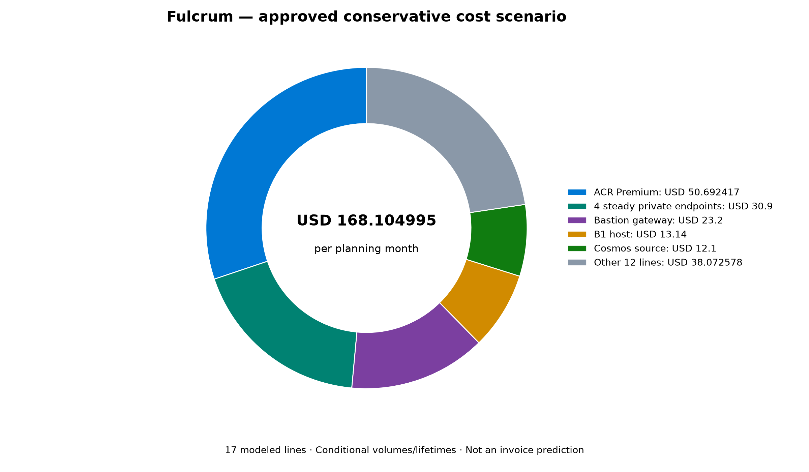
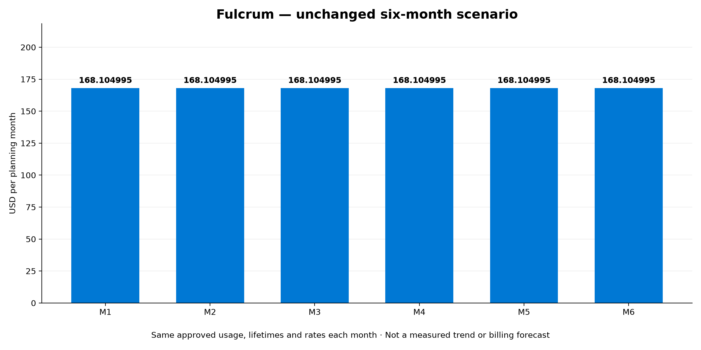

# 💰 Azure Cost Estimate: Project Fulcrum

[Review and approval status](README.md#-workflow-progress)

<strong>📑 Cost Estimate Contents</strong>

- [💵 Cost At-a-Glance](#-cost-at-a-glance)
- [✅ Decision Summary](#-decision-summary)
- [🔁 Requirements → Cost Mapping](#-requirements--cost-mapping)
- [📊 Top 5 Cost Drivers](#-top-5-cost-drivers)
- [🏛️ Architecture Overview](#-architecture-overview)
- [🧾 What We Are Not Paying For (Yet)](#-what-we-are-not-paying-for-yet)
- [⚠️ Cost Risk Indicators](#-cost-risk-indicators)
- [🎯 Quick Decision Matrix](#-quick-decision-matrix)
- [💰 Savings Opportunities](#-savings-opportunities)
- [🧾 Detailed Cost Breakdown](#-detailed-cost-breakdown)
- [References](#references)

> Generated by 03-Architect agent | 2026-11-09

**Assumed Corp policies—not tenant-verified; DEV Architecture-only.**
Runtime **Unverified**. This report is the **adopted conservative planning scenario**,
not actual spend, an applicable billing-tier assertion or an invoice prediction.
No Architecture approval, spending, Azure operation or deployment authority is implied.

| ⬅️ Previous | 📑 Index | Next ➡️ |
| --- | --- | --- |
| [Architecture](02-architecture-assessment.md) | [README](README.md) | Optional Design, then Governance after actual Gate2 |

**Region/environment:** Sweden Central /DEV only. No known subscription/stamp attribution.
**Pricing owner:** actual `cost-estimate-subagent`, Azure MCP pricing_get plus documented
public Retail Prices fallback. Latest composite evidence collection2026-11-09T18:19:28.172Z;
reused meter timestamps remain original, not refreshed.
**Pricing evidence:** [COMPLETE17-line result](contracts/02-cost-estimate.conservative-planning-v2.json)
and its exact source mappings; [current69 inputs](_meta/assessment-step-2.json).
Finalized bytes are reviewed; current approval status is recorded outside this document.

## 💵 Cost At-a-Glance

> **Full scenario monthly: USD168.104995** | **Annualized: USD2017.25994**
>
> Owner budget: **USD500–2,000/month soft planning range**, not a minimum spend,
> hard ceiling or expenditure authorization. Scenario is below that range.

| Status | Indicator |
| --- | --- |
| Scope coverage | ✅ All17 modeled project billing lines; all approved environments/stamps included (DEV only, no known stamp) |
| Cost trend | ⚠️ Not observed; six-month graphic repeats the unchanged scenario, not an actual forecast |
| Savings | Not quantified; no commitment/RI/SP/Spot/DevTest quote adopted |
| Compliance | ⚠️ Assumed Corp only; not tenant-verified, GDPR-certified or ready to deploy |
| Confidence | Medium; complete evidence-supported arithmetic, conditional volumes/lifetimes/shared allocation |

The total is complete **for the authorized17-line project scenario**. It is not
total tenant expenditure: inherited Defender, policy-owned external workspaces or
inter-region policy telemetry allocations remain outside project scope and unknown.
No unknown corporate charge is represented as zero.

## ✅ Decision Summary

- ✅ Confirmed before pricing: current rev2 SKUs, LRS lock, newVNet/subnets,80h
  provisioned access profile,730h host, recovery/data meters and current69 records.
- ✅ Actual monthly transfer choice: additional app **1 decimalGB**, unchanged
  NAT5GB → **MGN6GB**; separate unchanged **Bastion5GB**. Each uses its own highest
  verified paid native rate, with complete raw tier evidence.
- ✅ Conditional conservative allocations, not free-entitlement or discounted-tier claims:
  no shared free credits for transfer/ingestion/alerts; central DNS commercial
  allocation and temporary restored storage/backup full-month bound are explicit.
- ⏳ Later secure implementation bindings: real scope, DNS ownership, identities,
  application image/SDK, recipient endpoints, quota/capacity and authorized lifecycle.
- 🔁 Reconcile/reprice if effective policy changes monitoring/egress/DNS,
  quantities/lifetimes exceed envelopes, workload shapes change or evidence expires.

**Confidence: Medium. Expected variance:** not statistically quantified; no measured
traffic distribution, churn, deletion timing or tenant bill supports a percentage.
No additional usage question or silently adopted app5GB scenario is introduced.

## 🔁 Requirements → Cost Mapping

| Requirement | Selected architecture | Priced line(s) / monthlyUSD | Mandatory within scenario |
| --- | --- | --- | --- |
| Container host / private image | B1 host, ACR Premium, MI/private pull |13.14 /50.692417; endpoint billing separate | Yes |
| Primary documents /30day recovery | NoSQL serverless/source continuous backup/restore |12.1; temporary target4.805 andPE0.15 separate | Yes |
| LRS private documents/media | HotGPv2 withPITR and prerequisite storage/transactions |10.7552 | Yes; LRS remains user-pinned |
| Private consumers / DNS | Four steadyPEs; adopted shared DNS allocation |30.9 /2.4 | Yes; allocation is not deployment ownership |
| Sanitized30day diagnostics | Combined workspace ingest;4metric series/1log rule |2.99 /0.4 /1.5 | Yes |
| Ephemeral authorized access | VM/Bastion/NAT/disk/IPs |7.36 /23.2 /4.725 /1.230378 /0.8 | Yes; lifecycle conditional |
| Known outbound paths | Separate MGN6GB andBastion5GB paid bounds |0.957 combined allocation | Yes; not applied invoice tier |

Line values above are copied from the worker, not new parent pricing.
Endpoint/transfer/restore amounts are not added a second time to grouped descriptions.

## 📊 Top 5 Cost Drivers

| Rank | Billing line | MonthlyUSD | Trend evidence | Optimization boundary |
| --- | --- | ---: | --- | --- |
|1| ACR Premium |50.692417| No actual trend | Private Link forcesPremium; do not substituteBasic/Standard |
|2| Four steady private endpoints |30.9| No actual trend | Required app/data/image paths; no public-endpoint shortcut |
|3| Bastion Standard |23.2|80h scenario | Future authorized removal required;2baseunits already included |
|4| Linux B1 host |13.14|730h scenario | Candidate-backed minimum; performance validation before change |
|5| Cosmos source account |12.1|20mRU/10GB scenario | Monitor RU/storage/restore, not automatic retention downgrade |

**Quick win:** enforce the already selected ephemeral access lifecycle after
separate implementation/deletion authority. Savings beyond the quoted scenario
are not quantified or assumed.

<strong>Driver details</strong>

ACR includes its documentedPremium base storage allowance for the adopted10GB
images; noTasks/builds/optional replicas are selected. ItsPE is in the four-endpoint
line. Provider-managed paired-EU artifact storage is qualified, not optional
customer replication or application disaster recovery.

Bastion'sStandard Gateway base meter includes two mandatory units; it is billed
once for80h, not multiplied by2. Transfer is in the separate Internet allocation,
using Bastion's own fully captured native rate set. Neither VM deallocation nor
closing a session stops gateway/NAT/IP/disk billing.

## 🏛️ Architecture Overview

### Cost Distribution

The chart loads all17 worker lines; the five largest are shown separately and
the remaining twelve are aggregated once. The center retains the exact worker total.

[Editable SVG](assets/03-des-cost-distribution.svg) · [Python](assets/03-des-cost-distribution.py)

### Month-over-Month Projection

[Editable SVG](assets/03-des-cost-projection.svg) · [Python](assets/03-des-cost-projection.py)

Each ofM1–M6 repeats **USD168.104995**, assuming identical approved usage and lifetimes,
constant rates and no unmodeled scope. It is not telemetry/Cost Management forecast.
There is no hard-budget line or implied minimum spend.

### Key Design Decisions Affecting Cost

| Decision | Basis | Business rationale / status |
| --- | --- | --- |
| Private ACR/API/data | All requiredPEs andPremium registry priced | Baseline capability, not optional cost-saving removal |
| Ephemeral runner/access |80h provisioned each;80h/730 disk proration | ConfirmedDEV proportional access; no persistent80h-to730h app dependency |
| Continuous30day recovery | Paid source backup/restore plus target lifetime | Approved recovery; no seven-day fallback or free target |
| Conservative transfer | Each service's highest verified paid native rate | Owner-adopted allocation avoids asserting shared free entitlement |
| Minimal cost monitoring | Retains budget/operational alerts | Removes dedicated costAG/anomaly only; actual Owner recipient must be verified later |

## 🧾 What We Are Not Paying For (Yet)

- PROD, multi-region HA, optional geo-replication, extra app workers or deployment slots.
- A project KeyVault: actual required connection profile is MI/platformHTTPS;
  its SwedenSouth replication has no accepted exception. Secret-management baseline is not waived.
- VPN/P2S, publicVM NIC, edge/WAF gateway, APIManagement, AKS, relationalSQL,
  queue/broker/cache or standalone email/push transport.
- App code/tests, image builds/ACRTasks, custom certificates/domains or stored credentials.
- Dedicated costActionGroup and daily anomaly alert in approvedDEVminimal mode;
  operational alerts remain. Notification transport sub-meters are outside scoped billing.

### Assumptions & Uncertainty

The estimate includes **all known required project billables**, not an invented
zero for unknown usage. Owner-approved planning volumes are scenario inputs rather
than measurements. Central DNS is a four-zone/1million-query conservative allocation,
not a claim that the project deploys or exclusively owns those zones.
Corporate Defender/DINE/external telemetry costs are qualitative exposure, not
assumed project resources or free platform services.

## ⚠️ Cost Risk Indicators

| Resource / issue | Risk | Consequence | Mitigation |
| --- | --- | --- | --- |
| Access lifecycle | 🟡 Medium | Longer provisioning bills gateways/disk/IPs even if VM is deallocated | Authorized lifecycle automation and verification |
| Blob versions/feed | 🟡 Medium | Churn/lifecycle can exceed retained10GB/feed0.5GB | Measure retained bytes; preserve at least31day protection and revise estimate |
| Cosmos restored account | 🟡 Medium | Forgotten temporary account/PE increases storage/RU/backup/lifetime | Authorized cleanup; targetstorage/backup conservatively paid fullmonth already |
| Shared DNS / policy | 🟡 Medium | Actual ownership/effective policy may require different scope/cost | Governance verification before planning completion |
| App/control/telemetry wire | 🟡 Medium | Actual wire could exceed adopted1GB | Measure separately from1GB ingestion; do not reroute730h host through80hNAT |
| Tier/entitlement interpretation | 🟢 Source evidence complete; applicability still conditional | Allocations must not be presented as actual invoice bands | Retain complete raw tiers and explicit separate service maxima |

**Watch item:** this is a planning allocation conditional on volume/lifetime limits,
not a mathematically universal upper bound on the workload or tenant bill.

## 🎯 Quick Decision Matrix

| Requirement change | Incremental cost | SKU / design implication | Verdict |
| --- | --- | --- | --- |
| Production/zonal or regional-loss objectives | Not priced | Separate requirements/design; LRS and residency locks still apply | 🔴 New authority/design needed |
| All-traffic private/persistent monitoring route | Not priced | Existing selective app route no longer equivalent; persistent egress/monitoring reconciliation | 🔴 Governance/reprice before implementation |
| More access hours or traffic | Not priced as new scenario | Same native source reuse only while fresh/equivalent; quantities require owner authority | 🟡 Monitor actual usage |
| B1 insufficient at load test | B2 comparison exists; fullchanged scenario not adopted | Obtain actual sizing choice; preserve LRS/other pins | 🟡 Review after evidence |

No unqueried incremental dollar estimate or assumed discount is supplied.

## 💰 Savings Opportunities

### Savings: Not Quantified in This Run

Baseline on-demand consumption only. The worker reports `NOT_QUANTIFIED`;
RI/SP prices and realized savings were not requested/verified.

| Strategy | Applicability / prerequisite |
| --- | --- |
| Right-sizing | Three current comparison decisions support selectedDEV sizes; actual performance must be measured |
| Ephemeral lifecycle | Already included80h; no additional saving counted |
| Reservations / savings plans | No adopted commitment; need stableeligibleusage and fresh owner quotes |
| Spot / DevTest / free tiers | Not selected; no entitlement or savings inferred |
| Retention tuning | Cannot reduce approved30day recovery/diagnostics or31day prerequisites without owner/policy reconciliation |

## 🧾 Detailed Cost Breakdown

### Assumptions

- Four manifest lines plus thirteen supplements; allDEV, quantity/usage aggregate
  unless stated; effective subscription/stamp remain null, not fabricated.
- B1/steadyPEs730h. Access VM/Bastion/NAT/disk/twoIPs80h each; future authorized
  deletion, not deallocation, controls billed lifetime. ACR365/12billabledays.
- Blob20GB live +10GB retained versions/deletions +0.5GBfeed =30.5GB HotLRS;
  aggregate110kreads/20kwrites/10klists already include recovery. One20GB logical
  restore processes the adopted0.5GBfeed, **not20GB billedPITR data**.
- Cosmos source10GB/20mRU, paid30day10GBbackup/one10GBrestore/month.
  Temporary target4h/1mRU;10GBlive+backup charged fullmonth where hourly proration
  is unproven; source restore charge is not duplicated. TemporaryPE4h/1GBin/10GBout.
- Four steadyPEs730h **each**;40GB toward/130GB from aggregate **once**.
  Four-zone/1millionDNSquery allocation. One combined1GB workspace ingest30days,
  fourstaticmetricseries and one5minute logrule/resource.
- NAT25GBprocessed =20download+5outbound; bandwidth separately counts5outbound.
  Additional app1GB across730h; **MGN6GB** and **Bastion5GB separately**.
  Native catalog`1GB`; decimal`TB=1000GB`, `Tb=125GB` conversions describe rates,
  not monthlyTB/Tb quantities. Disk64GiB is not relabeled64decimalGB.
- Native complete MGN6bands andBastion5bands retained. Worker uses each service's
  highest verified paid`1GB` rate for the approved allocation, no free credits,
  tier discounts/inclusion or actual invoice placement. Combined0.957 is billed once.

### Line Items

| # | Worker billing line | Quantity / unit basis | MonthlyUSD |
| --- | --- | --- | ---: |
|1| Blob HotLRS +operations/PITR |30.5GB;110kread/20kwrite/10klist;500MBfeedprocessed |10.7552|
|2| Linux B1 host |1×730h |13.14|
|3| Cosmos source Serverless |20mRU;10GBlive/backup;10GBrestore |12.1|
|4| Linux D2as_v5 runner |1×80h |7.36|
|5| ACR Premium |1registry×365/12days;10GBimagesincluded |50.692417|
|6| Steady private endpoints |4×730h;40GBin/130GBoutaggregate |30.9|
|7| Shared private DNS allocation |4zones;1mqueries |2.4|
|8| Combined Insights/Logs |1GBingest;30dayretention |2.99|
|9| Operational metric alerts |4staticseries |0.4|
|10| Operational scheduled log alert |1rule/resource;5min |1.5|
|11| Bastion Standard gateway |80h;2baseunitsincluded |23.2|
|12| NAT Standard |80h+25GBprocessed |4.725|
|13| P6LRS OS disk |64GiB;80/730monthlyproration |1.230378|
|14| Standard staticIPv4 |2×80h;managedservicesnotVMNIC |0.8|
|15| Separate Internet allocation |MGN6GB+Bastion5GBpaidbounds |0.957|
|16| Temporary Cosmos restore target |1mRU+10GBlive/backupfullmonthbound |4.805|
|17| Temporary restore endpoint |4h;1GBin/10GBout |0.15|
| | **Full authorized scenario** | **AnnualUSD2017.25994** | **168.104995** |

### Notes

Actual owner publication is COMPLETE with17finite lines and no unresolved items;
six-decimal line rounding follows the worker. Monthly/annual sums were checked
with decimal arithmetic; reported figures are copied verbatim, not rounded here.
Four manifest price/timestamp updates only; no SKU/revision/pin change authorized.

History preserved: initial12MCP+1direct, recovery1oneMCP, recovery2zero,
recovery3fourteenMCP+sixdirect, calculation-onlyzero, final**zeroMCP+onedirect** =
**35/35**, remaining0. Comparison history3dispatches/7MCP is separate, not recounted.
The final exactBastion helper response has5rows/native tier minima/nullNextPageLink,
no retry or extra page. Earlier FAILED files remain immutable diagnostic history.
Static fresh-catalog preflight's13groups>1 diagnostic is retained honestly; it did
not authorize a new catalog run. Source reuse and the exact missing-tier extension
were explicitly authorized, and publication validates full scope.

## References

| Topic | Evidence |
| --- | --- |
| Actual complete estimate | [Versioned worker result](contracts/02-cost-estimate.conservative-planning-v2.json), [d07 raw envelope](contracts/02-cost-estimate.conservative-planning-v2.json.retail-evidence/d07-bastion.json) |
| Existing consumed source archive | [Recovery3 source ledger](contracts/02-cost-estimate.recovery-3.json), [fixedsource equations](contracts/02-cost-estimate.recovery-3.json.retail-evidence/fixed-scope-calculations.json), [q11 actual archive receipt](_meta/02-cost-recovery-3-archive-receipt.json) |
| Scope / authority | [Current69 projection](_meta/assessment-step-2.json), [monthly choice](_meta/02-monthly-planning-response-receipt.json), [exact request authority](_meta/02-bastion-evidence-extension-response-receipt.json), [new pricing request](_meta/02-cost-conservative-planning-v2-request.json) |
| Independent verification | [Read-only validator](_meta/02-cost-conservative-planning-v2-validation.py); [required cost review](reviews/challenge-findings-cost-estimate.json) |
| Billing semantics | [Official cached excerpts](_meta/02-final-official-evidence.json), [Cosmos backup](https://learn.microsoft.com/azure/cosmos-db/continuous-backup-restore-introduction), [Blob PITR](https://learn.microsoft.com/azure/storage/blobs/point-in-time-restore-overview) |
| WAF / cost management | [InsightsWAF](https://learn.microsoft.com/azure/well-architected/service-guides/application-insights), [LogsWAF](https://learn.microsoft.com/azure/well-architected/service-guides/azure-log-analytics), [Cost Management](https://learn.microsoft.com/azure/cost-management-billing/costs/overview-cost-management) |

| ⬅️ [Architecture](02-architecture-assessment.md) | 🏠 [Project Index](README.md) | ➡️ Optional Design / Governance after Gate2 |
| --- | --- | --- |
